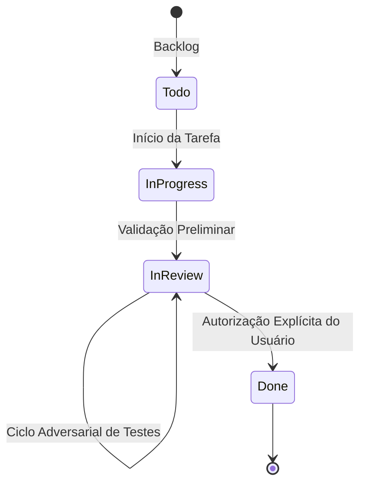

# Governança de Tarefas e Roadmap do Board

## 1. Ciclo de Vida do Project Board (Projeto 8)
A esteira de desenvolvimento obedece ao fluxo estrito estipulado no `AGENTS.md`:

- **Todo -> In Progress:** Seleção e início do desenvolvimento.
- **In Progress -> In Review:** Conclusão da implementação, aprovação no linter (`ruff check .`) e suíte de testes (`pytest`).
- **In Review:** Análise do usuário e testes contínuos sob perspectivas alternativas (casos de borda, estresse, comportamento adverso).
- **In Review -> Done:** Exclusivamente após autorização e validação formal do Senhor.

---

## 2. Inventário de Cards e Status no Board

| Issue | Tipo | Título | Status Atual | Escopo & Ajustes de Ambiente |
| :---: | :---: | :--- | :---: | :--- |
| **#1** | `feat(ui)` | Tela inicial de boas-vindas centralizada (Welcome State) | `Todo` | Exibir logo e prompt centralizados na abertura; transicionar para 2 colunas ao primeiro prompt (padrão OpenCode). |
| **#2** | `feat(ui)` | Refatoração visual do fluxo de mensagens do chat | `In Review` | Mensagens sem bordas pesadas, padding 1 2, barra lateral azul, thoughts colapsáveis (+ Thought), seleção nativa de Markdown e rodapé minimalista. |
| **#3** | `feat(ui)` | Redesenho da barra de entrada com sub-barra interna | `Done` | Sub-barra com modelo, modo e esforço; rodapé com tokens e path. |
| **#4** | `feat(ui)` | Barra lateral minimalista focada em contexto | `Done` | Sidebar retrátil (`Ctrl+B`) ocupando 100% da altura sem cortes horizontais. |
| **#5** | `feat(ui)` | Menu de autocomplete de comandos expandido (Slash Pop-up) | `Todo` | Pop-up com duas colunas alinhadas (comando + descrição) com seleção via teclado e Tab. |
| **#6** | `feat(core)` | Sistema de abas superiores para múltiplas sessões em paralelo | `Todo` | Gerenciamento de abas (`Ctrl+T`), isolamento de processos e alternância rápida. |
| **#7** | `feat(ui)` | Modais de diálogo flutuantes para ações (/model, /diff, /resume) | `In Review` | Modais flutuantes centralizados sobrepostos à viewport com fundo translúcido. |
| **#8** | `feat(core)` | Seletor de modelo versátil em duas etapas (Model + Effort) | `In Review` | Diálogo `/model` e atalho `Ctrl+M` guiando seleção de modelo e esforço de raciocínio. |
| **#9** | `fix(telemetry)` | Correção do cálculo de tempo de resposta por turno | `Done` | Medição de latência real por turno do envio ao evento de resultado. |
| **#10** | `feat(telemetry)` | Métrica de velocidade de geração em tokens por segundo (tok/s) | `Done` | Cálculo do throughput de tokens por segundo exibido na finalização do turno. |
| **#11** | `feat(ui)` | Refatoração ergonômica do ChatInput e rodapé no padrão OpenCode | `In Review` | Contêiner unificado sem bordas horizontais divisórias e alinhamento ergonômico com a coluna de mensagens. |

---

## 3. Próximos Passos Prioritários
1. **Validação e Conclusão de Revisão:** Aguardar validação do Senhor para mover cards em revisão (#2, #7, #8, #11) para `Done`.
2. **Card #1:** Implementação da tela inicial centralizada (Welcome State).
3. **Card #5:** Autocomplete de comandos expandido com alinhamento tabular.
